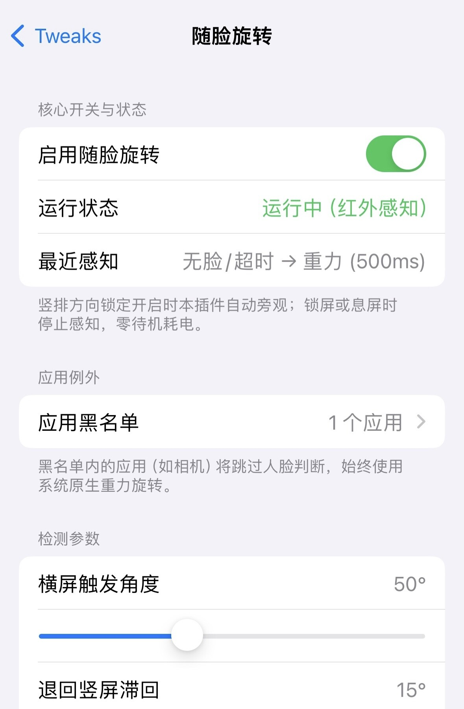
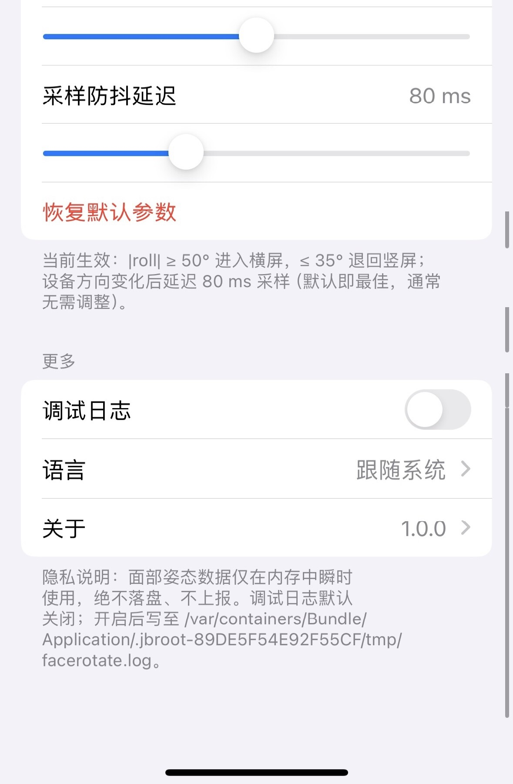

# FaceRotate (随脸旋转)

[English](#english) | [中文](#中文)

---

## English

**FaceRotate** is a face-aware auto-rotation jailbreak tweak for iOS powered by the TrueDepth infrared sensor. When Portrait Orientation Lock is off, the screen orientation aligns with the vertical axis of your head (`roll` angle) instead of gravity—preventing unwanted landscape flips while lying on your side and keeping landscape video steady in bed.

- **Architectures**: `arm64` / `arm64e`
- **Jailbreak Schemes**: `roothide` / `rootless`

### Requirements

1. **Device**: iPhone or iPad equipped with Face ID (TrueDepth infrared sensor).
2. **OS Version**: iOS 15.0 – 17.x.
3. **System Settings**: **Settings → Face ID & Passcode → Attention Aware Features** must be enabled (otherwise the tweak falls back to native gravity rotation).
4. **Control Center**: **Portrait Orientation Lock** must be off (matching native auto-rotation behavior).
5. **Dependencies**: `mobilesubstrate`, `preferenceloader`.

### How It Works

1. When an orientation change or arbitration occurs in SpringBoard, FaceRotate checks whether the tweak is active (enabled, screen unlocked/awake, Portrait Orientation Lock off, foreground app not in the blacklist, and Attention Aware Features enabled).
2. On-demand single polling via `AttentionAwareness` (`AWAttentionAwarenessClient`, without continuous face detection or activating the RGB camera—so no green privacy dot appears) asynchronously reads the user's `roll` angle without blocking the SpringBoard main thread.
3. Based on the configured trigger angle and hysteresis window, the target orientation is resolved:
   - `|roll|` within the upright threshold → Portrait
   - `roll > 0` beyond threshold → LandscapeLeft
   - `roll < 0` beyond threshold → LandscapeRight
   - `|roll| >= 135°`, no face detected, sensor obstructed, or timeout → Fail-open fallback to native gravity orientation
4. After debounce confirmation, the resolved orientation is applied through `SBTraitsInputsOrientationLockValidator` / `TRAArbiter` on iOS 16–17, or `SBDeviceOrientationUpdateManager` on iOS 15.

### Build & Package

Built with [theos-roothide](https://github.com/roothide/theos). The `Makefile` automatically re-signs binaries with `ldid -S` during `before-package::`. Always run `make clean` when switching package schemes.

#### roothide

```bash
THEOS=~/theos-roothide make clean
THEOS=~/theos-roothide make package THEOS_PACKAGE_SCHEME=roothide
```

#### rootless

```bash
THEOS=~/theos-roothide make clean
THEOS=~/theos-roothide make package THEOS_PACKAGE_SCHEME=rootless
```

Output `.deb` packages are placed in `packages/`.

### Privacy

Face pose data is processed strictly in memory for real-time orientation calculation and is never persisted or uploaded.

---

## 中文

基于 iOS TrueDepth 原深感红外传感器的**面容感知自动旋转**越狱插件。当屏幕未开启「竖排方向锁定」时，系统将根据用户头部垂直轴（`roll` 倾角）而非重力方向决定横竖屏，实现侧躺玩手机不误横屏、躺着看横屏视频不乱转的体验。

- **支持架构**：`arm64` / `arm64e`
- **越狱环境**：`roothide` / `rootless`

### 环境与使用前提

1. **设备要求**：配备 Face ID（TrueDepth 红外传感器）的 iPhone / iPad。
2. **系统版本**：iOS 15.0 – 17.x。
3. **系统设置**：需开启 **设置 → 面容 ID 与密码 → 注视感知功能**（否则自动回退至重力旋转）。
4. **控制中心**：需**关闭**「竖排方向锁定」（与原生自动旋转逻辑一致）。
5. **插件依赖**：`mobilesubstrate`、`preferenceloader`。

### 工作原理

1. 当系统方向发生变化或触发方向仲裁时，检查当前状态（总开关、锁屏/息屏、竖排锁定、前台 App 是否在黑名单、系统注视感知是否开启）。
2. 条件满足时，通过 `AttentionAwareness`（`AWAttentionAwarenessClient`，关闭连续检测模式，按需单次轮询，不调用前置 RGB 摄像头且无隐私绿点）异步获取当前人脸姿态 `roll` 角度，不阻塞 SpringBoard 主线程。
3. 根据触发倾角与滞回区间计算目标方向：
   - `|roll|` 处于竖屏回正区间 → 竖屏（Portrait）
   - `roll > 0` 且超出阈值 → 左横屏（LandscapeLeft）
   - `roll < 0` 且超出阈值 → 右横屏（LandscapeRight）
   - `|roll| >= 135°` 或无脸/遮挡/超时 → 自动回退原生重力方向
4. 经过防抖确认后，在 iOS 16–17 上通过 `SBTraitsInputsOrientationLockValidator` / `TRAArbiter`（iOS 15 上通过 `SBDeviceOrientationUpdateManager`）应用目标方向。

### 构建与打包

本项目使用 [theos-roothide](https://github.com/roothide/theos) 编译与打包，并在 `Makefile` 的 `before-package::` 阶段自动使用 `ldid -S` 对产物执行重签名。切换打包方案前务必先执行 `make clean`。

#### roothide 版本

```bash
THEOS=~/theos-roothide make clean
THEOS=~/theos-roothide make package THEOS_PACKAGE_SCHEME=roothide
```

#### rootless 版本

```bash
THEOS=~/theos-roothide make clean
THEOS=~/theos-roothide make package THEOS_PACKAGE_SCHEME=rootless
```

生成的 `.deb` 安装包位于 `packages/` 目录下。

### 隐私说明

人脸姿态数据仅在本地内存中用于实时方向计算，不会持久化存储或上传任何人脸特征、图像或姿态信息。

---

## Screenshot / 示例截图

<p> </p>
